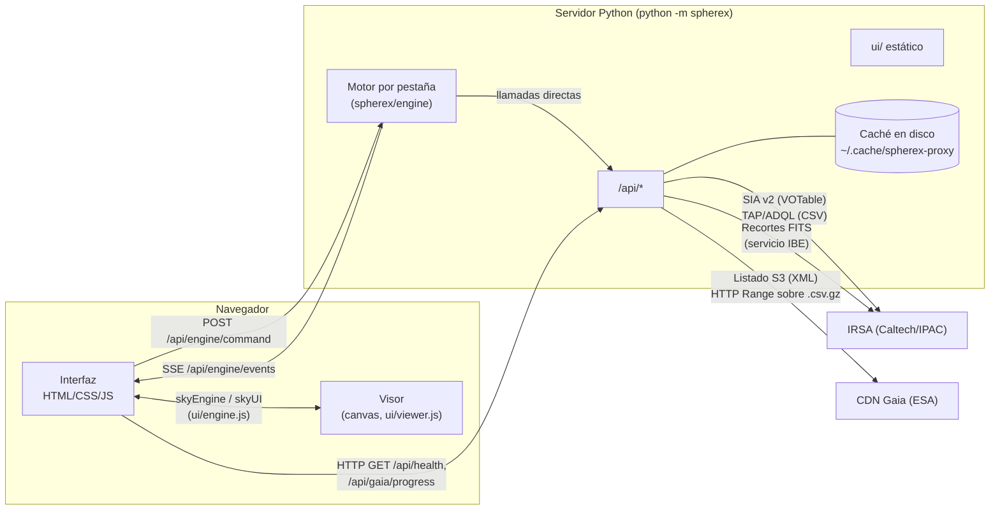
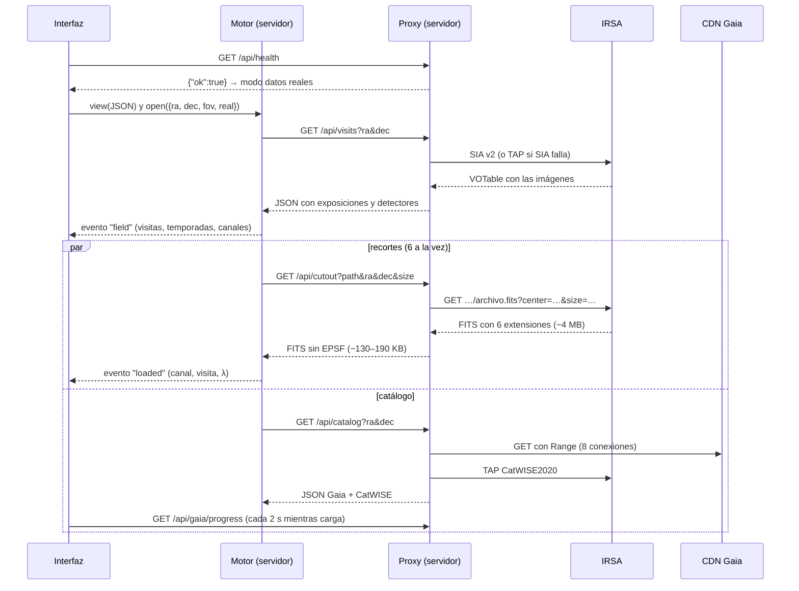

# Protocolos, transferencia de datos y arquitectura

Este documento describe cómo SPHEREx Sky Timeline obtiene, transporta, guarda y procesa los datos: qué servicios consulta, con qué protocolos, en qué formatos, cómo se reparten las peticiones y qué pasa cuando algo falla. Las operaciones numéricas (coordenadas, reproyección, fotometría, HEALPix…) están explicadas paso a paso, con código Python equivalente, en el notebook [`operaciones.ipynb`](operaciones.ipynb).

## 1. Arquitectura



Hay tres piezas:

- **Interfaz** (`ui/`): buscador, canales, línea de tiempo, paneles. Es dueña del estado de la app (URL, reproducción, nivel) y lo envía al motor. El visor (`ui/viewer.js`) dibuja en un `<canvas>` la imagen que compone el motor, con zoom, arrastre, capa de catálogo, selección, banderas, escala y brújula.
- **Motor** (`spherex/engine`, Python + numpy, uno por pestaña dentro del servidor): planea el campo, pide los datos, decodifica FITS, reproyecta, compone las imágenes, mide fotometría y movimiento, y manda al navegador la imagen ya coloreada y la geometría de las capas.
- **Proxy** (`spherex/proxy.py`, `spherex/server.py`): sirve la web y la API `/api/*`, habla con IRSA y con el CDN de la ESA, y guarda todo en una caché en disco. El motor lo usa con llamadas directas, sin pasar por HTTP.

### Por qué hace falta el proxy

Se comprobó desde un navegador real:

| Servicio | `Access-Control-Allow-Origin` | Desde el navegador |
|---|---|---|
| IRSA TAP, SIA y recortes | no se envía | bloqueado por CORS |
| CDN de Gaia (ESA) | `*` | permitido, pero cada archivo pesa ~230 MB |
| Mirror de Sesame en Harvard | `*` | permitido (búsqueda por nombre) |

IRSA no permite peticiones desde otra web, así que el proxy hace de intermediario y sirve la app desde **el mismo origen** que la API: el navegador nunca hace peticiones entre orígenes a `/api`. Para Gaia el proxy no es obligatorio, pero se usa por eficiencia (sección 3.6). Además, el proxy recorta lo que viaja al navegador (quita la capa PSF de los FITS) y cachea respuestas que en IRSA tardan de segundos a minutos.

## 2. Flujo de una sesión



En el diagrama, las flechas entre motor y proxy son llamadas dentro del mismo proceso; la interfaz habla con el motor por `POST /api/engine/command` y recibe sus eventos por Server-Sent Events (sección 4).

El motor empieza a descargar por las imágenes más cercanas a la cabeza de reproducción en el canal elegido, así que se puede reproducir antes de que termine la carga. La interfaz envía la vista (`view`) **antes** de abrir el campo para que esa prioridad sea correcta desde la primera petición.

Con datos reales solo se descarga **el canal que está en pantalla** (unas 60 imágenes en vez de ~360). Los demás se agregan a la cola cuando el usuario cambia a ellos, o todos a la vez cuando selecciona una fuente, porque su espectro necesita los seis. Cada vez que crece la cola, el motor manda un evento `loaded` con el nuevo total. En la simulación no hay descarga y se cargan los seis de inmediato.

## 3. Protocolos y servicios externos

### 3.1 HTTP

Todo viaja por HTTPS hacia fuera y por HTTP local entre navegador y proxy. Particularidades:

- El **límite de velocidad del CDN de Gaia es por conexión**. El cliente (`urllib`, HTTP/1.1) abre una conexión TCP nueva para cada petición `Range`, así que las 8 peticiones en paralelo usan 8 conexiones (sección 3.6). (Un cliente HTTP/2 las multiplexaría en una sola y perdería esa ventaja.)
- El motor limita a 6 los recortes en curso por pestaña, como haría un navegador con 6 conexiones por servidor; el límite global hacia IRSA lo pone el cliente (sección 7).

### 3.2 IVOA SIA v2: lista de imágenes (vía principal)

Simple Image Access devuelve las imágenes que contienen una posición. Es la vía que usa el tutorial de introducción de IRSA.

```
GET https://irsa.ipac.caltech.edu/SIA
    ?COLLECTION=spherex_dr1
    &COLLECTION=spherex_qr3
    &POS=circle <ra> <dec> 0.0003
    &RESPONSEFORMAT=VOTABLE
```

- **Respuesta**: VOTable 1.3 en XML con `TABLEDATA`. De la última tabla se usan las columnas `access_url` (URL del archivo) y `t_min` (MJD de inicio).
- **Tiempo observado**: unos 5 s.
- **Limitación**: SIA ve los datos nuevos con alrededor de un día de retraso respecto a TAP (la ingesta es semanal).

### 3.3 IVOA TAP con ADQL: lista de imágenes (respaldo) y CatWISE

Table Access Protocol en modo síncrono, con la consulta en ADQL y la respuesta en CSV:

```
GET https://irsa.ipac.caltech.edu/TAP/sync?LANG=ADQL&FORMAT=csv&QUERY=<ADQL>
```

Imágenes SPHEREx que contienen un punto (la consulta del tutorial de recortes):

```sql
SELECT a.uri, p.time_bounds_lower, p.energy_bandpassname
FROM spherex.artifact a
JOIN spherex.plane p ON a.planeid = p.planeid
WHERE 1 = CONTAINS(POINT('ICRS', <ra>, <dec>), p.poly)
ORDER BY p.time_bounds_lower
```

CatWISE2020 en un cono de 0.15°:

```sql
SELECT source_name, ra, dec, pmra, pmdec, w2mpro FROM catwise_2020
WHERE 1 = CONTAINS(POINT('ICRS', ra, dec), CIRCLE('ICRS', <ra>, <dec>, 0.15))
  AND (w1mpro < 15.5 OR w2mpro < 16.5)
```

TAP tarda de 30 s a varios minutos. Se usa para las imágenes solo si SIA falla (a cambio ve los datos del último día), y para CatWISE, que no tiene otra vía.

**Deduplicación de imágenes** (SIA y TAP): una misma exposición y detector puede aparecer reprocesada (`_retry`) o en dos entregas (QR3 y DR1). Del nombre `level2_<exposición>D<detector>_spx…` se saca la clave; si hay varias, se queda la de DR1 y, dentro de ella, la última por ruta.

**Estructura de las exposiciones**: en cada exposición un punto del cielo cae en **una pareja de detectores** (D1+D4, D2+D5 o D3+D6), porque los dos planos focales ven el mismo cielo a través del divisor dicroico. Una visita del motor es una exposición; los otros cuatro canales no tienen imagen en ella. Las visitas separadas por más de 40 días empiezan una nueva temporada (pasada del survey).

### 3.4 Servicio de recortes de IRSA (IBE)

Cada imagen de SPHEREx (2040×2040 píxeles por detector) se puede pedir recortada añadiendo parámetros a su URL:

```
GET https://irsa.ipac.caltech.edu/ibe/data/spherex/<entrega>/level2/<semana>/<versión>/<detector>/<archivo>.fits
    ?center=<ra>,<dec>d&size=<lado en grados>
```

- **Lado del recorte**: el recorte llega en la orientación del detector, rotado respecto al norte, así que debe cubrir las esquinas del campo norte-arriba en cualquier ángulo: `lado = campo × √2 × 1.02`. Para un campo de 6′ son 0.144° (unos 84 píxeles).
- **Contenido**: un FITS multiextensión con `PRIMARY`, `IMAGE`, `FLAGS`, `VARIANCE`, `ZODI`, `EPSF` y `WCS-WAVE`.
- **Tamaño**: `EPSF` es un cubo de PSF de unos 3.9 MB (el 97 % del archivo) que el motor no usa. **El proxy lo elimina**, y cada recorte pasa de ~4 MB a ~130–190 KB según el campo.

### 3.5 FITS

Formato de archivo de las imágenes. El módulo `spherex/fits.py` implementa lo mínimo:

- **Estructura**: bloques de 2880 bytes. Cada HDU (cabecera + datos) es una cabecera de tarjetas de 80 caracteres ASCII terminada en `END` y rellena hasta el bloque, seguida de los datos en big-endian, también rellenos.
- **Tamaño de los datos**: `|BITPIX|/8 × NAXIS1 × … × NAXISn`, más `PCOUNT`, por `GCOUNT`.
- **Quitar una extensión** es copiar las demás HDU tal cual, byte a byte, sin reinterpretar nada.

Extensiones y palabras clave que se usan:

| Extensión | Contenido | Uso |
|---|---|---|
| `IMAGE` (float32) | Brillo superficial en MJy/sr | Imagen. `MJD-AVG` da la fecha; `CTYPE`, `CRPIX`, `CRVAL`, `PC`, `CDELT` y los polinomios SIP `A_*`, `B_*`, `AP_*`, `BP_*` dan la posición; `CTYPE1W='WAVE-TAB'`, `CRPIX1W/2W` y `PS1_*W` dan la longitud de onda. |
| `FLAGS` (int32) | Máscara de bits por píxel | Bit *n* nombrado por `MSKNnnnn` y descrito por `MSKDnnnn`. |
| `VARIANCE` (float32) | Varianza por píxel, (MJy/sr)² | Errores de la fotometría. |
| `ZODI` (float32) | Modelo de luz zodiacal, no restado | Se resta para igualar el fondo entre visitas. |
| `EPSF` | PSF efectiva | Eliminada por el proxy. |
| `WCS-WAVE` (tabla binaria) | Rejilla 9×9 de puntos de control con (λ, ancho de banda) | Longitud de onda de cada píxel. |

### 3.6 CDN de Gaia DR3 (ESA)

Gaia DR3 está publicado como 3386 archivos `GaiaSource_AAAAAA-BBBBBB.csv.gz` de unos 230 MB (formato ECSV: comentarios `#` de metadatos, una línea de cabecera CSV y 152 columnas por fila).

**Listado**: el navegador de archivos del CDN lee un almacenamiento de tipo S3:

```
GET https://gaia.eu-1.cdn77-storage.com/?prefix=Gaia/gdr3/gaia_source/&delimiter=/[&marker=<última clave>]
```

La respuesta es XML (`ListBucketResult`) con `Contents/Key`, `Contents/Size` e `IsTruncated`, paginada de 1000 en 1000 claves con `marker`. El índice resultante se guarda en `gaia/index.json`.

**Organización espacial**: los números del nombre de archivo son el **rango de píxeles HEALPix de nivel 8** (esquema anidado, unos 0.23° de lado) que contiene, y las filas van ordenadas por `source_id`, que lleva el píxel de nivel 12 en sus bits altos (`source_id >> 35`). Así, el píxel de nivel 8 de una fila es `source_id >> 43`, y para un punto del cielo se sabe qué archivo leer sin descargar nada.

**Por qué no se puede saltar a mitad de un archivo**: cada `.csv.gz` es un único flujo gzip, sin puntos de sincronización. Para llegar a un píxel hay que descomprimir desde el principio.

**Método de transferencia** (streaming por teselas):

1. El campo de visión (cono de 0.15° más margen) se traduce en los píxeles de nivel 8 que toca, y cada píxel en su archivo.
2. El archivo se descarga con **peticiones `Range` en paralelo** (`Range: bytes=a-b`, respuesta `206 Partial Content`): trozos de 4 MiB, 8 conexiones independientes, como mucho 8 trozos en memoria (32 MiB). Un lector los entrega **en orden** al descompresor gzip.
3. Las líneas se leen sobre la marcha. Cada vez que cambia el píxel de nivel 8, la tesela anterior se escribe en disco y se avisa a quien la estaba esperando.
4. La petición de la app se responde **en cuanto pasan sus píxeles**. El resto del archivo se sigue procesando en segundo plano, sin estar ligado a ninguna petición, para cachear también las zonas vecinas.
5. Al terminar el archivo se escribe la marca `done-<archivo>`.

Velocidad medida: unos 1 MB/s por conexión y de 0.8 a 4 MB/s en total según el momento. Un archivo nuevo tarda de 1 a 6 minutos; después la zona responde al instante. Se hace en el servidor y no en el navegador para no repetir cientos de MB por usuario y para compartir la caché. Las teselas y el índice tienen el mismo formato que en la versión anterior en Go, así que una caché ya descargada sigue sirviendo.

### 3.7 Sesame (búsqueda por nombre)

La interfaz resuelve nombres de objetos con Sesame (CDS) directamente desde el navegador:

```
GET https://vizier.cfa.harvard.edu/viz-bin/nph-sesame/-oI/SNV?<nombre>
```

Si falla, prueba con `vizier.idia.ac.za` (cada intento tiene 5 s de límite). La URL principal de CDS redirige sin cabeceras CORS, así que se usan los mirrors directamente. De la respuesta en texto se leen `%J` (posición J2000) y `%P` (movimiento propio), que se usa para llevar la posición a la fecha actual.

## 4. Comunicación entre la interfaz y el motor

El motor corre en el servidor, uno por pestaña. Cada pestaña genera un identificador de sesión al azar y abre un flujo de eventos (`GET /api/engine/events?session=…`, Server-Sent Events); al conectarse por primera vez el servidor crea su motor y le manda `ready`. Los comandos van por `POST /api/engine/command` con `{"session", "cmd", "args"}`, uno detrás de otro y en orden (`ui/engine.js`); de `hover` solo se manda la última posición pendiente.

Dentro del servidor, los comandos y los resultados de las descargas no tocan el estado del motor directamente: encolan una función (`App.post`) que el hilo del motor ejecuta en orden. Si el flujo de eventos se corta, los eventos esperan en la cola y llegan al reconectar; de `image`, `overlay`, `frame` y `hover` solo se manda el más reciente. Un motor sin flujo conectado durante 60 s se cierra.

`ui/engine.js` mantiene la misma API que tenía el motor en WebAssembly, así que `ui/app.js` no cambió:

**De la interfaz al motor** (`globalThis.skyEngine`, argumentos JSON en texto):

| Función | Argumentos | Efecto |
|---|---|---|
| `open(json)` | `{ra, dec, fov, name, real}` | Abre un campo; `real` usa el proxy. |
| `view(json)` | `{band, mode, visit, ref, flags, catalog, tint}` | Canal (0–5), modo (`epoch`/`diff`/`sum`), visita, referencia (−1 automática) y capas. |
| `zoom(f)`, `fit()` | factor | Zoom del visor (local, en `ui/viewer.js`). |
| `resize(w, h)` | píxeles | Tamaño del canvas (local). |
| `pointer(dentro)` | booleano | Sin efecto: el visor sigue el puntero por su cuenta. |

El visor manda además `select {x, y}` al hacer clic (sin arrastrar) y `hover {x, y}` (o `null`) al cambiar de píxel.
| `clearSelection()` | — | Quita la fuente seleccionada. |

**Del motor a la interfaz** (`globalThis.skyUI.event(tipo, json)`):

| Evento | Contenido |
|---|---|
| `ready` | Los 5 objetos de prueba con posición actual y canal y modo sugeridos. |
| `status` | Fase (`visits`, `catalog`), estado (`loading`, `done`, `empty`, `error`), error, número de elementos y catálogos que faltaron. |
| `field` | Visitas (fecha, temporada, sub-banda), disponibilidad por canal, tamaño, si es real y unidad de flujo. |
| `loaded` | Imágenes recién cargadas: canal, visita, λ en el centro y si se pudo leer. Incluye el progreso total. |
| `frame` | La imagen mostrada: fecha, λ, referencia usada, archivo, fondo, ruido, píxeles marcados y número de imágenes apiladas. |
| `hover` | Píxel bajo el cursor: coordenadas, valor y banderas. |
| `select` | Fuente seleccionada: posición, movimiento propio con errores, trayectoria, todas las medidas (canal, visita, λ, flujo, error, fiable) y la fuente de catálogo que coincide. |

Dos eventos más los consume el visor y no llegan a `skyUI`:

| Evento | Contenido |
|---|---|
| `image` | `{n, rgba, flags}`: la imagen compuesta ya coloreada (RGBA en base64) y, con la capa de banderas activa, un byte por píxel que marca los malos. `rgba: null` deja el recuadro vacío (visita sin imagen). |
| `overlay` | Geometría en píxeles de imagen: centro del campo, marcadores de catálogo (posición en su época, posición en la fecha actual, flecha) y la selección (anillos de apertura y anillo de fondo, recta del movimiento, detecciones). |

## 5. API del proxy

Todas las respuestas de `/api/*` llevan `Access-Control-Allow-Origin: *`. Los errores son JSON `{"error": "…"}` con estado 400 (parámetros inválidos) o 502 (falló el servicio externo).

| Método y ruta | Parámetros | Respuesta | Caché |
|---|---|---|---|
| `GET /api/health` | — | `{"ok":true}`; con `--sim`, `{"ok":false}` y la interfaz usa la simulación | — |
| `GET /api/visits` | `ra`, `dec` (grados) | `{ra, dec, source: "SIA"\|"TAP", fetched, visits: [{path, mjd, detector, exposure, release}]}` | 24 h en disco; cabecera `X-Cache: HIT\|MISS` |
| `GET /api/cutout` | `path` (ruta del archivo en el archivo de IRSA), `ra`, `dec`, `size` (≤ 0.3°) | FITS (`application/fits`) sin `EPSF` | Permanente en disco; `Cache-Control: public, max-age=31536000, immutable` |
| `GET /api/catalog` | `ra`, `dec` | `{ra, dec, radius: 0.15, sources: [{catalog, name, ra, dec, pmra, pmdec, mjd, mag}], missing?: ["CatWISE2020"]}` | Permanente si está completa; CatWISE tiene su propia entrada |
| `GET /api/gaia/progress` | `ra`, `dec` | `[{file, fraction, mb}]` de los archivos de Gaia que se están descargando para ese campo | — |
| `GET /api/engine/events` | `session` | Flujo SSE de eventos del motor (sección 4) | — |
| `POST /api/engine/command` | JSON `{session, cmd, args}` | `{}`; 400 si el comando no es válido, 404 si la sesión no existe | — |
| `GET /…` | — | Archivos de `ui/` | `Cache-Control: no-cache` (un cambio se ve al recargar) |

Unidades en el catálogo: `pmra` y `pmdec` en mas/año (`pmra` incluye cos δ), `mjd` es la época de la posición (57388.5 = J2016.0 para Gaia, 57170.0 = 2015.4 para CatWISE) y `mag` es G (Gaia) o W2 (CatWISE). Solo se incluyen las fuentes de Gaia con G < 19.

**Validación**: `path` debe empezar por `ibe/data/spherex/`, terminar en `.fits` y no contener `..`, `?`, `#` ni `\`. Así el proxy no sirve para pedir cualquier otra cosa a IRSA ni a otros servidores.

## 6. Caché

Todo vive en `~/.cache/spherex-proxy` (o en la carpeta indicada con `-cache`).

| Qué | Clave o ruta | Validez |
|---|---|---|
| Lista de imágenes | `visits <ra> <dec>` | 24 h (IRSA añade datos cada semana) |
| Recorte sin EPSF | `cutout <path> <ra> <dec> <size>` | permanente (la ruta incluye la versión de procesado) |
| Catálogo completo | `catalog <ra> <dec> 0.150 gaia-cdn` | permanente |
| CatWISE | `catwise <ra> <dec> 0.150` | permanente |
| Teselas de Gaia | `gaia/tiles/<píxel/1000>/<píxel>.bin` | permanente |
| Archivo de Gaia terminado | `gaia/done-<archivo>` | permanente |
| Índice del CDN | `gaia/index.json` | permanente |

- **Ubicación de las entradas**: se guardan en `<sha256(clave)[:2]>/<sha256(clave)>`.
- **Escritura atómica**: archivo temporal y `rename`, así una caída nunca deja medio archivo.
- **Peticiones simultáneas**: si llegan varias con la misma clave, solo se ejecuta una vez la consulta y las demás esperan su resultado.
- **Redondeo**: las posiciones se redondean a 0.0005° (1.8″), en el proxy y en el motor. La posición actual de un objeto rápido, como WISE 0855 a 8″/año (0.022″/día), cambia el sexto decimal del centro (0.0036″) cada ~4 horas; sin redondeo la clave de cada recorte cambiaría varias veces al día y casi nunca coincidiría con las del precalentamiento. Con 1.8″ la clave dura unas 11 semanas.

**Formato de las teselas de Gaia**: binario little-endian, 40 bytes por fuente, sin cabecera.

| Bytes | Campo | Tipo |
|---|---|---|
| 0–7 | `source_id` | int64 |
| 8–15 | `ra` (grados, J2016) | float64 |
| 16–23 | `dec` (grados, J2016) | float64 |
| 24–27 | `parallax` (mas) | float32 |
| 28–31 | `pmra` (mas/año) | float32 |
| 32–35 | `pmdec` (mas/año) | float32 |
| 36–39 | `phot_g_mean_mag` | float32 |

Los valores `null` del CSV se guardan como NaN. Un píxel sin archivo de tesela, dentro de un archivo marcado como terminado, no tiene fuentes.

## 7. Concurrencia

Cada tipo de petición tiene sus propios turnos, para que lo lento no bloquee lo urgente:

| Dónde | Límite | Motivo |
|---|---|---|
| Motor → proxy (recortes) | 6 a la vez por pestaña | Como las conexiones por servidor de un navegador. |
| Proxy → IRSA (recortes) | 8 (`-parallel`) | Los tutoriales de IRSA recomiendan de 7 a 12. |
| Proxy → IRSA (listas de imágenes) | 2 | Camino crítico de la app; consultas pesadas. |
| Proxy → IRSA (catálogos TAP) | 2 | Muy lentas; no deben ocupar los turnos de lo anterior. |
| Proxy → CDN de Gaia | 2 archivos × 8 conexiones | Ancho de banda y CPU de descompresión. |

- **Cancelación**: la espera por un turno termina si el usuario abre otro campo o cierra la pestaña. Una vez empezada, la descarga sigue hasta el final (dentro de su plazo) para que el resultado quede en caché.
- **Precalentamiento**: al arrancar, el proxy pide en serie las listas de imágenes y luego los catálogos de los 5 objetos de prueba, para no saturar los servicios.

## 8. Tolerancia a fallos

| Capa | Qué se reintenta | Cómo |
|---|---|---|
| Proxy → IRSA | Errores de red y respuestas 5xx | 3 intentos, con esperas de 1 s y 2 s. Los 4xx no se reintentan. |
| Proxy → CDN de Gaia | Cada trozo de 4 MiB | 4 intentos, con esperas de 2, 4 y 6 s. |
| Motor → proxy | Recortes con error transitorio (red o 5xx) | Vuelven a la cola tras 20, 40, 80 y 160 s; después quedan como hueco en la línea de tiempo. |
| Listas de imágenes | SIA caído | Se repite la consulta por TAP. |
| Catálogo | CatWISE lento o caído | Se espera como mucho 20 s tras tener Gaia (1 s si ya hay una consulta de CatWISE en curso para esa zona); se responde con Gaia y `missing: ["CatWISE2020"]`, sin guardar en caché, y CatWISE sigue en segundo plano. El motor vuelve a pedir el catálogo cada 30 s (hasta 20 veces) y, cuando CatWISE termina, actualiza la capa sin reabrir el campo. |

Plazos por petición, contados una vez obtenido turno: 90 s para un recorte, 8 min para una consulta TAP o SIA.

Un recorte ilegible (FITS corrupto o sin las extensiones necesarias) no se reintenta: se marca como hueco. Los errores llegan a la interfaz como estados (`status`) con mensajes en lenguaje llano y la opción de pasar a la simulación.

## 9. Rendimiento observado

| Operación | Tiempo o tamaño |
|---|---|
| SIA, lista de imágenes | ~5 s (358 imágenes para Barnard) |
| TAP, lista de imágenes | 27–58 s |
| TAP, cono de Gaia de 0.15° en IRSA (ya no se usa) | ~150 s |
| TAP, CatWISE | ~130 s, con frecuentes 502 durante las pruebas |
| Recorte de 6′ | 1.4 s en condiciones normales; 10–90 s con IRSA degradado |
| Recorte | 4 MB → 130–190 KB sin EPSF |
| Archivo de Gaia (230 MB) | 1–6 min la primera vez; una zona del cielo ocupa ~23 MB en teselas |
| Cualquier respuesta cacheada | milisegundos |

## 10. Convenciones

- **Coordenadas**: ICRS en grados. Los píxeles del motor van con el norte arriba y el este a la izquierda, a 6.15″ por píxel. En la rejilla del motor el píxel *i* cubre [*i*, *i*+1); en los recortes FITS se usa la convención de astropy (base 0, el centro del primer píxel en 0).
- **Tiempo**: MJD. Épocas de referencia: J2000 (posiciones de los objetos de prueba, de Simbad), J2016.0 (Gaia DR3) y MJD 57170 (CatWISE2020).
- **Unidades**:
  - Imágenes en MJy/sr.
  - Fotometría en mJy: suma en la apertura × ángulo sólido del píxel en sr × 10⁹.
  - Longitudes de onda en µm.
  - Movimientos propios en mas/año en los datos y en ″/año en la interfaz.

La simulación usa las mismas estructuras y bits de banderas que los datos reales, así que todo el código posterior (composición, fotometría, seguimiento) es común.
